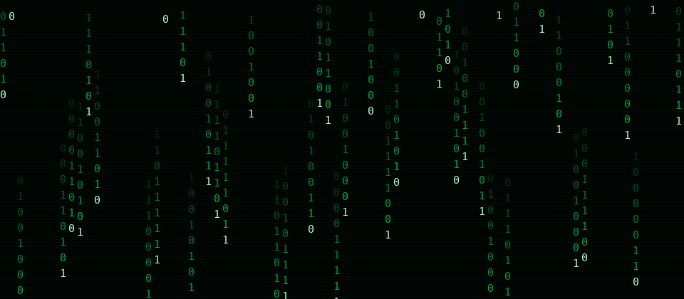

# Luciano S. Costa

### Desenvolvedor Python | TI | Cybersecurity

---

## `> whoami`

Sou desenvolvedor com foco em **Python, Java e tecnologia**, interessado em construir soluções úteis, automatizar processos e compreender a segurança dos sistemas.

Atualmente curso **Análise e Desenvolvimento de Sistemas** e mantenho uma rotina de aprendizado contínuo. Meu objetivo é evoluir tecnicamente e atuar em projetos cada vez mais robustos nas áreas de desenvolvimento, cloud e cibersegurança.

## `> tech_stack`

## `> current_mission`

- Aprofundar meus conhecimentos em **Python e desenvolvimento Java**.
- Evoluir em **cloud computing** e infraestrutura.
- Desenvolver competências práticas em **cibersegurança**.
- Construir projetos consistentes e avançar rumo ao nível **sênior**.

## `> github_activity`

## `> contact`

- **GitHub:** [github.com/lucianooeste](https://github.com/lucianooeste)
- **E-mail:** [lucianosoeste@gmail.com](mailto:lucianosoeste@gmail.com)

---

`ACCESS GRANTED` · Sempre aprendendo. Sempre construindo.

